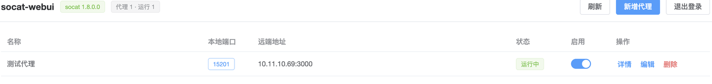
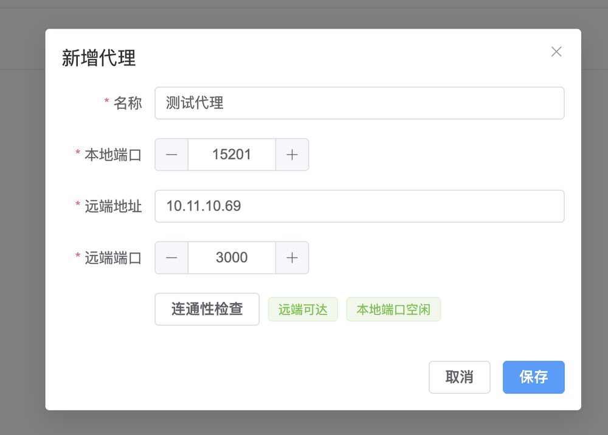
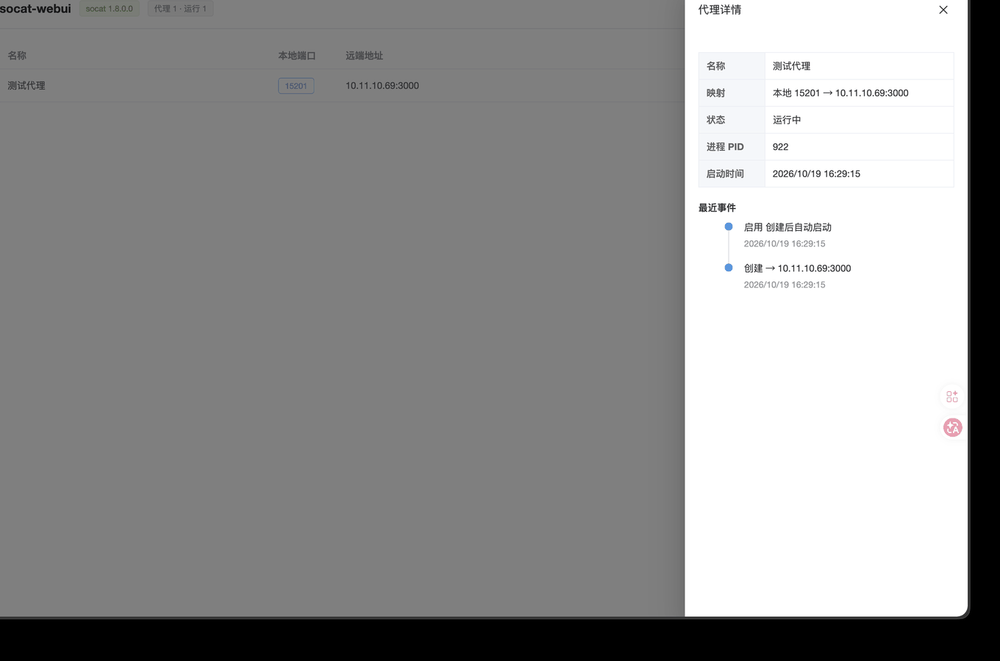

# socat-webui

[socat](https://repo.or.cz/socat.git) 的 WebUI 控制面板：把本机所在网段其他服务器的地址（IP:Port）映射到本地指定端口，在浏览器里完成端口映射的增删改查、启停与状态监控。

前后端分离开发，合并打包为**单一二进制**交付——拷一个文件到服务器，一条命令注册 systemd 服务，即可通过浏览器管理所有 socat 端口映射。

## 为什么需要它

在内网运维中经常需要这样的转发：把数据库、中间件、内部系统的地址统一映射到某台跳板机的端口上，团队成员只记一个入口。手工维护 socat 命令和 systemd 单元有这些问题：不可视化、状态不透明、重启后忘记恢复、配置漂移无人知晓。socat-webui 把这一切交给浏览器：

- **映射即服务**：增删改查、启停都在 WebUI 完成，前置检查（远端连通性 + 本地端口占用）避免配错
- **状态真实**：列表状态以 socat 进程实际运行情况为准，异常退出自动退避重启，失败原因直接可见
- **重启无忧**：映射配置与期望状态持久化到 SQLite，服务重启或整机重启后自动恢复到重启前的状态
- **单文件交付**：前端静态资源嵌入二进制，交叉编译产物为静态链接可执行文件，无运行时依赖（socat 除外）

## 功能特性

- 单二进制交付：`go:embed` 嵌入 Vue 3 前端，`CGO_ENABLED=0` 静态编译，支持 `linux/amd64` 与 `linux/arm64`
- systemd 自注册：`install` / `uninstall` 子命令完成注册、开机自启与卸载
- 代理管理：新增（前置检查）、列表、详情（进程 PID / 重启次数 / 事件时间线）、修改、停用/启用、删除
- 实际状态管理：状态来自真实进程；异常退出按 1s/5s/30s 退避自动重启，连续 3 次失败标记 failed，稳定运行后计数清零
- 状态持久化与重启恢复：恢复先于 HTTP 监听，WebUI 可访问即代表恢复完成；本地端口被占或 socat 缺失时标记失败并记录原因，不影响其他映射
- 依赖检测：实时探测 socat，缺失时页面醒目提示、代理操作被拒绝（可中途安装 socat，无需重启程序）
- 单密码认证：bcrypt 哈希落库、登录 token 24 小时有效、同 IP 连续错误限速

## 技术栈

| 层级 | 技术 |
| --- | --- |
| 后端 | Go + [Gin](https://github.com/gin-gonic/gin) + [GORM](https://gorm.io) |
| 前端 | Vue 3 + TypeScript + Vite + [Element Plus](https://element-plus.org) |
| 数据库 | SQLite（[glebarez/sqlite](https://github.com/glebarez/sqlite) 纯 Go 驱动，交叉编译无需 CGO） |
| 外部依赖 | [socat](https://repo.or.cz/socat.git)（端口映射执行器） |

## 环境要求

- Linux 服务器（`install` 需要 systemd 与 root；开发调试支持 macOS）
- 已安装 socat（`apt install socat` / `yum install socat` / `brew install socat`）
- 构建需要 Go 1.27+ 与 pnpm

## 界面预览

**代理列表**——状态以 socat 实际进程为准，自动刷新：



**新增代理**——保存前可即时检查远端连通性与本地端口占用：



**代理详情**——运行信息与事件时间线：



## 安装

### 方式一：从源码构建

```bash
git clone https://github.com/goubo/socat-webui.git
cd socat-webui

make build-linux-amd64    # 或 build-linux-arm64
# 产物：bin/linux_amd64/socat-webui（静态链接，无运行时依赖）
```

### 方式二：下载 Release 二进制

到 [Releases](https://github.com/goubo/socat-webui/releases) 页面下载对应架构的二进制。

## 快速开始

### 服务器部署（推荐）

```bash
# 1. 上传二进制
scp bin/linux_amd64/socat-webui root@your-server:/usr/local/bin/

# 2. 服务器上安装 socat（若尚未安装）
sudo apt install socat        # Debian/Ubuntu
sudo yum install socat        # RHEL/CentOS

# 3. 注册 systemd 服务并启动（root）
sudo /usr/local/bin/socat-webui install --port 15200 --password '你的面板密码'

# 卸载（数据目录保留，可手动删除）
sudo /usr/local/bin/socat-webui uninstall
```

安装后浏览器访问 `http://<server-ip>:15200`。服务名 `socat-webui`，数据目录 `/var/lib/socat-webui/`。

### 前台运行（开发 / 临时使用）

```bash
./socat-webui serve                                          # 默认 0.0.0.0:15200
./socat-webui serve --listen 127.0.0.1 --port 18080 --db ./data.db
```

首次启动若未设置密码，将在标准输出打印一次性初始密码。

## 使用说明

1. 浏览器打开面板，输入密码登录（token 24 小时有效，过期自动跳回登录页）
2. 点击「新增代理」，填写名称、本地端口、远端地址与端口
3. 可先点「连通性检查」即时确认远端可达与本地端口空闲，再保存
4. 列表中实时查看状态（运行中 / 已停止 / 失败 / 重启中），用开关启停，用「详情」查看进程信息与事件记录
5. 删除前会二次确认，进程与配置一并清理

### 配置项

优先级：命令行参数 > 环境变量 > 默认值。

| 参数 | 环境变量 | 默认值 | 说明 |
| --- | --- | --- | --- |
| `--listen` | `SOCAT_WEBUI_LISTEN` | `0.0.0.0` | WebUI 监听地址 |
| `--port` | `SOCAT_WEBUI_PORT` | `15200` | WebUI 监听端口 |
| `--db` | `SOCAT_WEBUI_DB` | serve：当前目录 / install：`/var/lib/socat-webui/proxies.db` | SQLite 数据文件 |
| `--socat-path` | `SOCAT_WEBUI_SOCAT` | 查 PATH | socat 可执行文件路径 |
| `--password`（仅 install） | `SOCAT_WEBUI_PASSWORD` | 交互输入或首启自动生成 | 面板密码（只存 bcrypt 哈希） |

### REST API

所有接口在 `/api` 前缀下，除登录外均需 `Authorization: Bearer <token>`：

| 方法 | 路径 | 说明 |
| --- | --- | --- |
| POST | `/api/auth/login` | 密码换 token |
| POST | `/api/auth/logout` | 注销 token |
| GET | `/api/health` | socat 探测与代理统计 |
| GET / POST | `/api/proxies` | 列表 / 新增 |
| GET / PUT / DELETE | `/api/proxies/:id` | 详情（含事件）/ 修改 / 删除 |
| POST | `/api/proxies/:id/enable` `/disable` | 启用 / 停用 |
| POST | `/api/proxies/precheck` | 远端连通 + 本地端口检查 |

## 安全说明

- 程序设计为 **root 运行**（绑定特权端口、管理子进程、写 systemd 单元），因此内置单密码认证作为最低安全线
- 面板默认监听 `0.0.0.0`，公网暴露场景请配合防火墙限制来源，或用 `--listen` 收敛到内网地址
- 密码只存 bcrypt 哈希，登录连续失败按 IP 限速；除密码哈希外不保存任何 secret

## 开发

```bash
pnpm --dir web install      # 前端依赖
make dev                    # 前端 dev server（/api 代理到 127.0.0.1:15200）
go run ./cmd/socat-webui serve   # 另开终端跑后端

make test                   # 全量测试（本机安装 socat 后包含真实转发集成用例）
make verify-linux           # Docker systemd 容器内验证 install / 整机重启恢复
```

项目结构与模块划分见各目录源码；构建入口统一在 `Makefile`。

## License

[MIT](./LICENSE)
